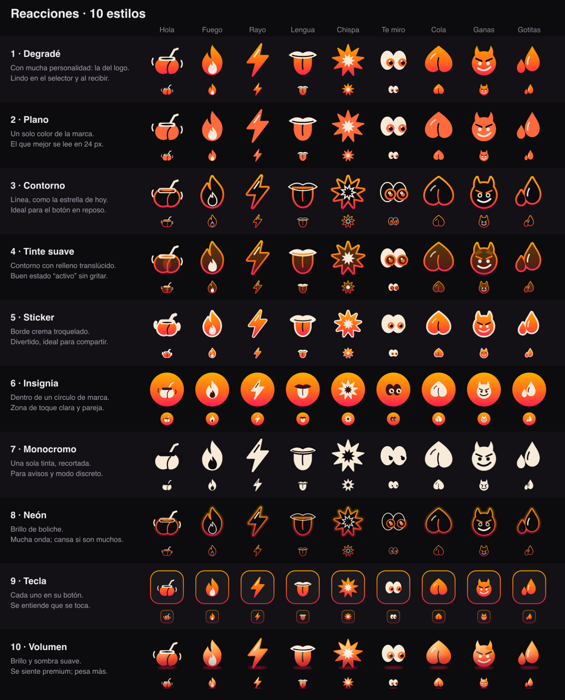
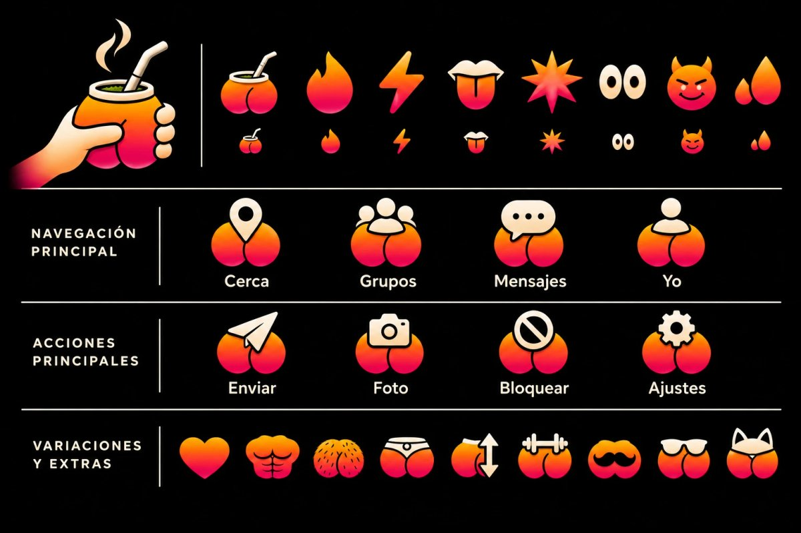

# Reacciones

Los íconos de los toques y de las reacciones a mensajes. Están dibujados en el mismo mundo que el logo (el mate culo):
el degradé de amarillo a magenta, el crema de la bombilla y la raya negra como detalle.

Los que usa la app están en `apps/web/public/reacciones/` (estilo 1, Degradé). El botón de toque sin usar es el rayo en contorno (`toque.svg`).

| Clave | Nombre | Para qué |
|---|---|---|
| `hola` | Hola | Te cebo un mate: el saludo |
| `fuego` | Fuego | Estás que ardés |
| `rayo` | Rayo | Me electrizaste |
| `lengua` | Lengua | Con ganas, en tono pícaro |
| `chispa` | Chispa | Me llamaste la atención |
| `ojitos` | Te miro | Te estoy mirando |
| `ganas` | Con ganas | El diablito |
| `gotas` | Gotitas | Lo dejamos a tu imaginación |

## Estilos explorados

## Propuesta de sistema (idea para seguir)

Usar la forma del mate culo como base de toda la iconografía: navegación, acciones y extras.

